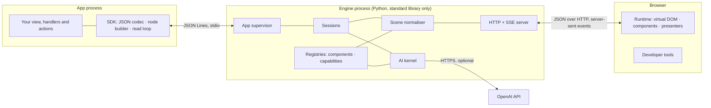
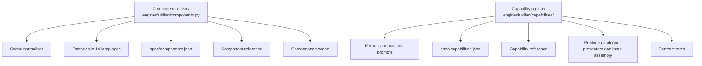

# Architecture

Fluidian has three parts that run as separate processes and talk over two small protocols.

## The engine

`engine/fluidian/` is one Python package with no third-party dependencies.

| Module | Responsibility |
| --- | --- |
| `server.py` | HTTP server, server-sent events, sessions, app supervision, security checks |
| `components.py` | Component registry, scene normaliser, diffing, digesting, transport encoding |
| `kernel.py` | The capability pipeline: cache, budget, router, telemetry, ledger, consent, guard |
| `capabilities/` | The registry of 185 capabilities in fifteen family modules |
| `reflex/` | The offline engine: text, parsing, data, design, scene composition, review, behaviour |
| `openai_client.py` | Provider client with parameter negotiation and retries |
| `schema.py` | A compact schema notation compiled to strict JSON Schema, with a validator |
| `colors.py` | OKLCH colour maths, contrast measurement and repair, theme tokens |
| `codegen.py` | Emitters for the fourteen SDK languages, project layouts and scaffolding |
| `convert.py` | Cross-language conversion: capture, handler plans, emission, verification |
| `platforms.py` | Design-token export and native shell projects |
| `procs.py` | Stopping child processes without failing, the server lifeline, free ports, launch records for test browsers, and removing what an interrupted run left behind |
| `cli.py` | The `fluidian` command |
| `testkit/` | Conformance harness, mock provider, Chrome DevTools driver, test runner |

The engine starts the app as a child process, sends it `open`, `event`, `route` and `close` messages, and receives scenes. It holds one session object per browser tab: route, locale, the latest normalised scene, an event queue for the SSE stream, recent interaction signals and the action history.

## The runtime

`runtime/` is served exactly as it is on disk.

| File | Responsibility |
| --- | --- |
| `core.js` | A small virtual DOM: `h`, keyed patching, server-side rendering to a string |
| `components.js` | Renderers for the core components, formatting, the Markdown subset, charts in SVG, syntax colouring |
| `blocks.js` | Marketing, commerce, chat, terminal, player, device-frame and mobile-screen components |
| `viz.js` | Sparklines, rings, gauges, heatmaps, funnels, candlesticks, maps, calendars and roadmaps |
| `art.js` | Procedural artwork: 44 kinds of product and scene illustration drawn as SVG |
| `logic.js` | Portable logic: the expression parser and interpreter, bindings, actions and page state |
| `ai.js` | The sixteen presenters and the AI-native components |
| `app.js` | Session boot, the event stream, forms, signals, themes, platform detection, developer tools |
| `icons.js` | 182 line icons |
| `static.js` | Server-side rendering entry point for export and tests |
| `sw.js`, `embed.js` | The service worker for installed apps and the `<fluidian-app>` element |
| `tokens.css`, `themes.css`, `themes.js` | Generated design tokens: the default scheme pair and the twenty-seven presets |
| `brand.js`, `logo.svg`, `pwa/` | The Fluidian mark as the runtime draws it, the favicon and the installable-app icons, generated by `tools/brand.py` |
| `fluidian.css`, `skin.css`, `blocks.css`, `platform.css` | Structure, the look of core components, the newer components, and the iOS and Android skins |

There is no build step and no framework. The same component renderers run in the browser and under Node.js, which is how `fluidian export` and the runtime tests work.

## The SDKs

An SDK is deliberately small: a JSON reader and writer (in languages without one in the standard library), a node builder, a read loop, and a generated file of component factories. It does not render, validate or call models; those belong to the engine. This is why adding a capability or a component never requires changing fourteen codebases, and why an SDK for another language is an afternoon's work against the [protocol](protocol.md) and the conformance transcript.

## The registries

Two declarations drive everything else.

`./fluidian codegen` regenerates the factories, specs and golden transcript; `./fluidian docs` regenerates the reference pages. The test suite fails if generated files are stale.

## Data flow for one interaction

1. The person clicks a button. The runtime posts `{name, target, value, form, payload}` to `/_fluidian/event` with the session token.
2. The engine forwards an `event` message to the app over stdin.
3. The handler runs. If it calls `ctx.ai`, the SDK writes `ai.invoke` and blocks; the engine runs the kernel on a worker thread and replies with `ai.result`. Messages that arrive in between are queued by the SDK and processed afterwards, in order.
4. The SDK calls the view and writes a `scene` message.
5. The engine normalises the scene and pushes it to the session's event stream.
6. The runtime patches the DOM. Attachments whose input changed call `/_fluidian/ai` directly; the app is not involved.

## Design decisions

**Server-driven, not client-side.** Application logic stays in your language and your process, next to your data. The browser receives descriptions, never code.

**stdio, not sockets.** A child process with pipes needs no ports, no discovery and no authentication, works identically in every language, and is trivially testable: the conformance harness is a pipe and a script.

**Blocking AI calls in handlers.** `ctx.ai` returns a value. Handlers read top to bottom in every language, including those without async primitives.

**Capabilities in the engine.** Prompts, schemas, safety and fallbacks are written once, reviewed once and upgraded once.

**An offline implementation for everything.** It makes the framework testable, demonstrable and dependable, and it gives the kernel somewhere to go when the provider is unavailable.
