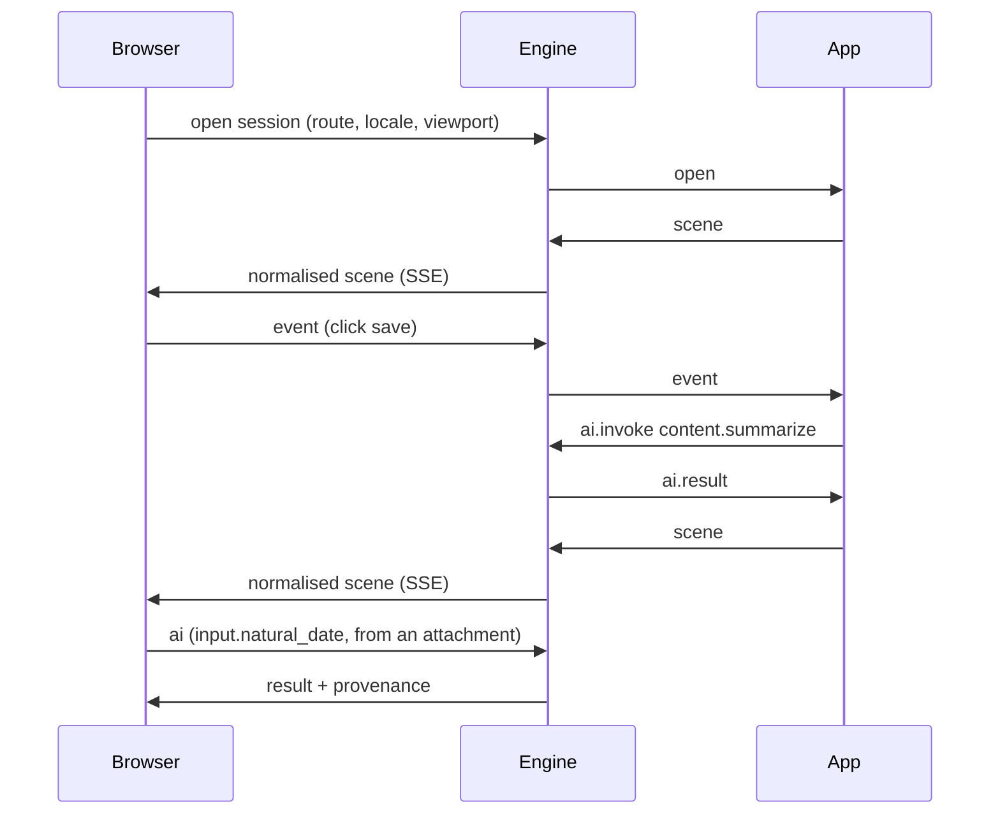

<p align="right"><a href="../README.md"></a></p>

# Concepts

Seven ideas explain everything Fluidian does.

## 1. A scene is data

An interface is a tree of **nodes**. A node has a type, props, children, event bindings and AI bindings:

```json
{
  "type": "Button",
  "id": "save",
  "props": { "label": "Save", "variant": "primary" },
  "on": { "click": { "action": "save_invoice", "payload": { "draft": false } } },
  "ai": [{ "capability": "content.microcopy", "options": {} }]
}
```

You never write this JSON. Each SDK has a factory per component and four chainable methods:

```python
ui.button("Save").prop("variant", "primary").id("save").on("click", "save_invoice", {"draft": False}).ai("content.microcopy")
```

Because a scene is data, it can be validated, diffed, stored, tested, exported to static HTML and, importantly, generated.

## 2. The view is a function of state

An app registers one view function. It receives a context and returns the scene for the current route and state. The engine calls it after every handler; you never patch the interface by hand.

```python
@app.view
def view(ctx):
    return ui.page("Inbox", ui.text(f"{len(ctx.state.get('items', []))} items"))
```

State is **per session**. Each browser tab gets its own `ctx.state`; nothing is shared unless your code shares it.

## 3. Events call named actions

Components emit events (`click`, `change`, `submit`, `select`, …). A binding maps an event to an **action name**; the app registers a handler for that name.

```python
ui.form("contact", ...).on("submit", "send")

@app.on("send")
def send(ctx, event):
    ctx.state["sent_to"] = event.form["email"]
```

A handler receives the event's `value`, the enclosing form's values in `form`, and the binding's `payload`. It may change state, show a toast, navigate, or call the kernel.

## 4. The engine normalises everything

Every scene passes through the normaliser before it reaches a browser. It assigns stable ids, checks props against the component registry, drops bindings to actions that do not exist, and reports each repair. In development the repairs are shown in the browser; in tests they fail the build. The gallery's test asserts zero repairs on every page.

## 5. A capability is typed AI behaviour

A capability has an id, an input shape, an output shape, and a **surface** that says how its result is presented. There are two ways to use one.

**Attach it to a component.** The runtime gathers the input from the component, calls the kernel at the right moment and presents the result.

```python
ui.input("when").ai("input.natural_date")                    # runs on blur, writes the parsed value
ui.chart("line").prop("data", rows).ai("data.anomaly")       # runs on render, marks the outliers
ui.text_area("reply").ai("input.tone_dial")                  # adds a menu; shows a diff before applying
```

**Call it from a handler.** The call blocks and returns a validated object.

```python
plan = ctx.ai("command.plan", {"goal": "create an invoice for Globex then send a reminder"})
for step in plan["steps"]:
    ...
```

The sixteen surfaces are listed in the [capability reference](reference/capabilities.md#surfaces).

## 6. Actions make an app operable by language

An action is a handler with a description and typed parameters:

```python
@app.action("create_invoice", "Create a new invoice for a customer",
            {"customer": "string customer name", "amount": "number amount in USD", "due": "date due date"})
def create_invoice(ctx, event):
    args = event.payload     # {"customer": "Globex", "amount": 300, "due": "2026-11-27"}
```

Registered actions are what the Intent Bar (<kbd>Ctrl</kbd>+<kbd>K</kbd>), the Copilot component and the planner can call. The kernel never invents an action: output that names an unregistered one is discarded. Actions the kernel rates as risky are routed through the Approval component.

## 7. Two providers, one contract

Every capability can be answered two ways:

| | Reflex | Reason |
| --- | --- | --- |
| What | Deterministic code in the engine | An OpenAI model with a strict JSON schema |
| Needs | Nothing | `OPENAI_API_KEY` |
| Latency | Under a few milliseconds | Model-dependent |
| Used when | No key, offline mode, tests, budget exhausted, provider failing, or the capability is `direct` | A key is set |

Both return the same shape, checked against the same schema, so the interface code does not change. Every result carries **provenance** — provider, model, latency, confidence, a trace id — and the runtime shows it as a chip next to generated content.

## 8. Behaviour can live in the scene

Interaction that only changes what is shown does not need a handler. A `State` node declares values, any string prop reads them with `{{ }}`, `Show` and `Each` shape the tree, and an action that starts with `@` runs in the runtime:

```python
ui.state().prop("values", {"count": 0})
ui.text("{{ count }}")
ui.button("Add one").on("click", "@count += 1")
```

Because this behaviour is data, it is the same in every SDK language and wherever the scene is rendered. [Portable logic](portable-logic.md) is the full guide.

## 9. One scene, every language and platform

A scene is JSON, so two things follow. Any SDK can produce it, and [`fluidian convert`](convert.md) can rewrite an application from one language into another and check that both serve identical scenes. And any device that runs the runtime can show it: the runtime applies the iOS or Android control skin, the engine serves an installable web app, and one element embeds it elsewhere. See [Cross-platform](cross-platform.md).

## Putting it together



Next: [Architecture](architecture.md) for the processes behind this diagram, or the [SDK guide](sdks.md) for your language.
