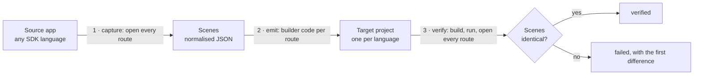

<p align="right"><a href="../README.md"></a></p>

# Converting between languages

`fluidian convert` takes an application written with any Fluidian SDK and writes the same application as a runnable project in any of the other languages. Then it proves the result: every generated project is built, started and compared with the source, route by route.

```bash
./fluidian convert app.py --to go                 # one language
./fluidian convert app.py --to go,rust,kotlin     # several
./fluidian convert app.py --to all --probe        # all thirteen others, and reproduce simple handlers
./fluidian run converted/go                       # run a result
```

Any of the fourteen languages can be the source, and any can be the target.

## Contents

- [How it works](#how-it-works)
- [What the source can be](#what-the-source-can-be)
- [What you get](#what-you-get)
- [What converts, exactly](#what-converts-exactly)
- [Handlers](#handlers)
- [Verification](#verification)
- [Options](#options)
- [Writing applications that convert completely](#writing-applications-that-convert-completely)
- [Limits](#limits)

## How it works

The converter does not parse or translate source text. A Fluidian application is a program that answers "what is on this route?" with a scene, so the converter asks.



1. **Capture.** The source application is started and asked for the scene of `/`. Every internal route referenced in that scene (navigation items, links, breadcrumbs, `go` payloads, `@go` actions) is opened in turn, and so on until no new route appears. Each scene is normalised against the component registry.
2. **Emit.** Each scene becomes a function in the target language, written with that SDK's own factories and naming conventions. A router maps routes to functions. Declared actions keep their name, description and parameters. Every action a scene binds gets a handler.
3. **Verify.** The generated project is built with the target toolchain and started. The same routes are requested and each scene is compared with the source, node for node. With `--probe`, recorded handler calls are replayed and compared too.

Because both ends are the same protocol, no language pair is special. Converting Rust to PHP uses exactly the code path that converts Python to Go.

## What the source can be

| You pass | Example | How it is started |
| --- | --- | --- |
| A source file in an interpreted language | `app.py`, `app.js`, `app.rb`, `app.php`, `app.lua`, `app.exs`, `app.dart` | With that language's interpreter, the SDK from this checkout on its path |
| A project folder | `my-go-app/`, `converted/rust/` | From `fluidian.project.json` if present, otherwise from the layout `fluidian new` produces (`main.go`, `Cargo.toml`, `Main.java`, `app.kt`, `Program.cs`, `app.cpp`, …); build steps run first |
| Any start command | `-- ./server --flag`, `-- java -jar app.jar` | Exactly as given |
| A scene file | `scenes.json` | Not started: one scene, a map of routes to scenes, or the `scenes.json` a previous conversion wrote |

```bash
./fluidian convert my-go-app/ --to python
./fluidian convert --to kotlin -- ./target/release/server
./fluidian convert scenes.json --to all
```

## What you get

```
converted/
├── scenes.json                 every captured route, usable with `fluidian serve` and as a conversion source
├── go/
│   ├── main.go                 one function per route, the router, the handlers
│   ├── go.mod
│   └── fluidian.project.json   how to build and run it; read by `fluidian run converted/go`
├── rust/
│   ├── Cargo.toml
│   ├── src/main.rs
│   └── fluidian.project.json
└── …
```

Generated code is meant to be read and owned. This is the Go output for one route of the example application:

```go
func tripsScreen() *fl.Node {
	return fl.Theme(
		fl.Shell("Field Notes",
			fl.Page("Trips",
				fl.Grid(
					fl.Card(
						fl.Art("coast").Prop("hue", 205).Prop("ratio", "16:9").Prop("label", "Skerry Point"),
						fl.Row(
							fl.Badge("14 notes").Prop("tone", "brand"),
							fl.Button("Open").Prop("variant", "primary").Prop("size", "sm").OnWith("click", "go", fl.M{"route": "/trips/skerry-point"}),
						).Prop("justify", "between"),
					).Prop("title", "Skerry Point").Prop("subtitle", "12 to 14 June"),
					// …
```

and its handlers, as reproduced with `--probe`:

```go
	app.On("go", func(ctx *fl.Ctx, ev fl.Event) {
		if payload, ok := ev.Payload.(fl.M); ok {
			if route, ok := payload["route"].(string); ok {
				ctx.Navigate(route)
			}
		}
	})
	app.On("share", func(ctx *fl.Ctx, ev fl.Event) {
		ctx.Toast("Link copied to the clipboard", "success")
	})
```

## What converts, exactly

| Part of the application | Result | Checked by |
| --- | --- | --- |
| Components, nesting, props, ids | Exact | Scene comparison |
| Themes, platform options, artwork | Exact; they are props | Scene comparison |
| AI attachments and their options | Exact | Scene comparison |
| Event bindings and payloads | Exact | Scene comparison |
| Portable logic: `State`, `Show`, `Each`, `{{ }}` bindings, `@` actions | Exact; behaviour is data in the scene | Scene comparison |
| Declared actions: name, description, parameters | Exact | Comparison of the `ready` message |
| Routes | One function per route reached from `/` or named with `--route` | One comparison per route |
| Handlers that only notify or navigate | Reproduced with `--probe` | Replay against the target |
| Handlers with other logic | A marked stub, or a model translation with `--port-handlers` | Stubs are not checked; translations must pass everything above |
| View code that depends on server state | The scene of the initial state | See [Limits](#limits) |

## Handlers

A handler is code in the source language, and the converter is honest about which ones it can carry across.

**Default: stubs.** Every action keeps its name and declaration and gets a handler that says so when it runs:

```python
@app.action("export_notes", "Export every note as a file", {"format": "string csv or json"})
def on_export_notes(ctx, event):
    # Handler bodies are application code: write this one for your Python backend.
    ctx.toast("Export notes: the handler is not ported yet", "warning")
```

**`--probe`: reproduce what can be observed.** Each handler is called on the source application, once per distinct call site and payload, in a fresh session, and then a second time in the same session. A handler is reproduced when:

- all it did was show notifications or navigate,
- the screen afterwards is exactly the screen of the route it ended on,
- the second call did the same as the first (so it does not depend on state), and
- every call site agrees on the shape: a constant message, a constant route, or a route taken from the same payload key.

Anything else stays a stub. In the example, `go` and `share` are reproduced; `plan_trip` is not, because its message counts up between calls.

> Probing calls your handlers. Use it against a development instance, not against an application whose handlers send email or charge cards.

**`--port-handlers`: translate with the model.** The source file is sent to the `dev.port` capability with the target language. The translation replaces the generated main file only if the project then builds and passes the same verification as the deterministic version. If it does not, the deterministic project is restored and the translation is kept beside it as `ported.rejected.<ext>.txt` for you to review. This needs `OPENAI_API_KEY`; the offline engine never claims to translate.

## Verification

```
  ✓ Go          verified  6 routes identical to the source, 5 handler calls replayed  0.1s
  ✗ Rust        failed    /trips differs from the source at $.children[0].props.title: expected "Trips", got "Trip"
  – Kotlin      skipped   toolchain not installed: kotlinc
```

| Status | Meaning |
| --- | --- |
| `verified` | The project built, started, and every route (and every replayed handler call) matched the source |
| `failed` | It did not build or start, or something differed; the first difference is printed with its path |
| `skipped` | The project was written but the language's toolchain is not installed; run `scripts/setup-ubuntu.sh` |
| `unchecked` | `--no-verify` was given |

The command exits with status 1 if any target failed, so it can gate a pipeline. `--json` prints the full report.

Two results from this repository's own test suite: the six-route example converts to all fourteen languages as part of every SDK's checks, and the 85-screen showcase (86 routes, about 5,400 lines of generated code per language) converts to the thirteen other languages with every route identical.

## Options

| Option | Effect |
| --- | --- |
| `--to LANGS` | Comma-separated targets, or `all` (the default). Short names work: `js`, `ts`, `rs`, `cs`, `c++`, `kt`, `rb`, `ex`, `py` |
| `-o, --out DIR` | Output folder; default `./converted` |
| `--route PATH` | Also capture this route. Repeat it for routes nothing links to |
| `--no-follow` | Capture only `/` and the routes given with `--route` |
| `--probe` | Call each handler on the source and reproduce those that only notify or navigate |
| `--port-handlers` | Translate handler code with the model; keep a translation only if it verifies |
| `--no-verify` | Write the projects without building and comparing |
| `--json` | Machine-readable report |
| `-- COMMAND` | Start the source application with this command |

The same pipeline is available from Python:

```python
from fluidian import convert

bundle = convert.capture(convert.locate("app.py"), probe=True)
reports = convert.convert(bundle, ["go", "rust"], "converted")
assert all(r["check"]["status"] == "verified" for r in reports)
```

## Writing applications that convert completely

An application converts with nothing left to finish when its behaviour is either portable logic or simple enough to observe.

- **Put client behaviour in the scene.** Counters, filters, tabs, toggles, form drafts, carts and anything else that only changes what is shown can be written with `State`, bindings and `@` actions. See [Portable logic](portable-logic.md). It runs in the runtime, so it needs no handler in any language.
- **Call the kernel from the scene.** `@ask content.summarize {text: draft} -> summary` invokes a capability and stores the answer in page state without a handler.
- **Keep handlers for what only a server can do**: reading and writing your data. These are the handlers you would want to write by hand in the new language anyway.
- **Link your routes.** Routes are found by following links from `/`; pass `--route` for the rest.

## Limits

- **Dynamic views are captured in their initial state.** If a view builds its scene from server state (`for row in ctx.state["rows"]`), the converter sees the scene that state produces when a session opens. The structure converts; the loop does not. Move the loop into an `Each` node, or port that view by hand or with `--port-handlers`.
- **Probing observes one call per call site.** It establishes what a handler did, twice, not what it would do for inputs it never saw. That is why only notification and navigation are reproduced, and why the result is replayed before it is reported.
- **A model translation is a draft until it verifies.** Verification covers every captured scene and every probe. Logic that those do not exercise is not covered; review translated handlers as you would any contribution.
- **Capture stops at 200 routes** and reports how many more were referenced.
