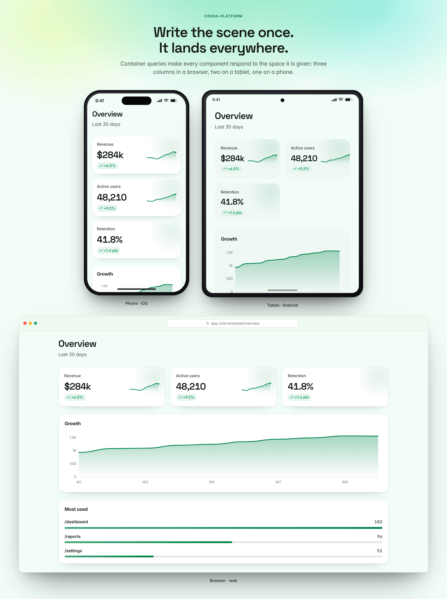
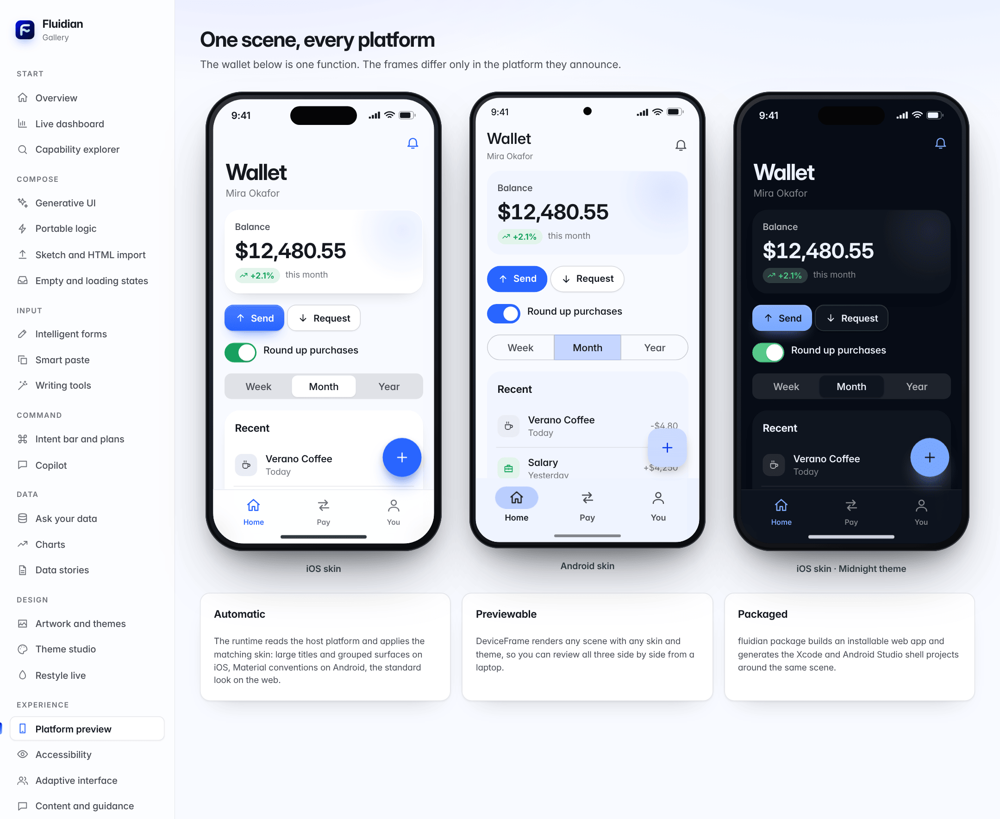

<p align="right"><a href="../README.md"></a></p>

# Cross-platform

A Fluidian application is a stream of scenes; the runtime decides how each scene looks where it lands. That is why one application, unchanged, covers the web, phones and tablets, installed apps, embeds and native shells.

| You want | You do | Section |
| --- | --- | --- |
| The same app in a desktop browser, on an iPhone and on an Android phone | Nothing | [Platform skins](#platform-skins) |
| Layouts that suit a phone, a tablet and a wide screen | Nothing | [Responsive by container](#responsive-by-container) |
| A mobile screen with a title bar, tabs and a floating action | Use `Screen` | [Mobile screens](#mobile-screens) |
| To preview several devices side by side | Use `DeviceFrame` | [Device frames](#device-frames) |
| An app people install from the browser | Nothing; serve it over HTTPS | [Installable web app](#installable-web-app) |
| The app inside another website | One element | [Embedding](#embedding) |
| An iOS, Android or desktop app | `fluidian package` | [Native shells](#native-shells) |
| Your theme in Tailwind, SwiftUI, Compose, Flutter or Figma tooling | `fluidian tokens` | [Design tokens](#design-tokens) |
| A page with no server at all | `fluidian export` | [Static export](#static-export) |
| The app in another programming language | `fluidian convert` | [Converting between languages](convert.md) |

## Platform skins

The runtime sets `data-fl-platform` on the document to `ios`, `android` or `web`, and `runtime/platform.css` restyles controls to match the conventions of each.

| | iOS | Android |
| --- | --- | --- |
| Screen title | A large display title above the content | A title in a top app bar |
| Bottom tabs | A tab bar with icons and labels | A navigation bar with a pill behind the active icon |
| Buttons | Rounded rectangles; tall primary buttons | Fully rounded, flat, filled |
| Switches | The wide switch that turns green | The Material switch with a growing thumb |
| Segmented controls and search | Inset, system style | Outlined segments, pill search |
| Cards, tiles and stats | Large radius, soft shadow, no border | Tonal surface tinted with the brand, no shadow |
| Dialogs | A sheet attached to the bottom edge | A centred dialog |
| Floating action | A round button | A rounded square, optionally with a label |

On the `web` platform, components keep the look the theme gives them.

How the platform is chosen, in order:

1. `?platform=ios`, `android`, `web` or `desktop` in the address;
2. a hint from a native shell (`window.FluidianHost.platform`), which the shells written by `fluidian package` provide;
3. the user agent.

```bash
./fluidian showcase --open
# then add ?platform=android to any /mobile/… address
```

You never branch on the platform in application code. The scene is the same; only its skin changes.

## Responsive by container

Components respond to the space they are given, using CSS container queries, rather than to the window. A `Grid` with four columns becomes two and then one as its container narrows; a `Split` stacks; a `Table` scrolls inside its card; a `Stat` shrinks its number to fit.

The consequence is that a scene placed in a phone-sized frame lays out as it would on a phone, even on a desktop screen. That is what makes the side-by-side previews below honest, and it is why an embedded app adapts to the column it is put in.



## Mobile screens

`Screen` is the mobile counterpart of `Page`: a title area, scrolling content, optional bottom tabs and a floating action. It takes its skin from the platform.

```python
ui.screen("Wallet",
    ui.stat("Balance", "$12,480.55").prop("delta", "+2.1%"),
    ui.row(ui.button("Send").prop("variant", "primary"), ui.button("Request")),
    ui.list().prop("items", transactions),
).prop("subtitle", "Mira Okafor") \
 .prop("tabs", [{"label": "Home", "icon": "home", "active": True}, {"label": "Pay", "icon": "swap"}, {"label": "You", "icon": "user"}]) \
 .prop("fab", {"icon": "plus"})
```

Fourteen phone screens built this way are in the showcase under **Mobile and cross-platform**: banking, fitness, food ordering, travel, music, chat, weather, habits, smart home, shopping, onboarding and sign-in.

## Device frames

`DeviceFrame` renders any scene inside a phone, tablet, browser or window frame, with its own platform skin and theme. Use it for documentation, design reviews and marketing pages.

```python
ui.row(
    ui.device_frame(wallet()).prop("kind", "phone").prop("platform", "ios"),
    ui.device_frame(wallet()).prop("kind", "phone").prop("platform", "android"),
    ui.device_frame(wallet()).prop("kind", "phone").prop("platform", "ios").prop("theme", "midnight"),
)
```

| Prop | Values |
| --- | --- |
| `kind` | `phone`, `tablet`, `browser`, `window` |
| `platform` | `ios`, `android`, `web` |
| `theme` | Any of the twenty-seven presets |
| `scheme` | `light`, `dark` |
| `width`, `height`, `scale` | Size of the frame |
| `url`, `title`, `caption`, `time` | Frame furniture |



## Installable web app

The engine serves everything a browser needs to offer installation:

| Address | What it is |
| --- | --- |
| `/manifest.webmanifest` | Name, colours and icons, taken from your application's name and theme |
| `/sw.js` | A service worker that caches the application shell |
| `/_fluidian/runtime/pwa/` | Icons at 192 and 512 pixels, a maskable icon and an Apple touch icon |

On an iPhone or iPad, people use **Share → Add to Home Screen**. On Android and in desktop Chrome or Edge, the browser offers **Install**. The result opens in its own window with no browser chrome, uses the platform skin, and respects the safe areas of the device.

The service worker caches only the shell: the page and the runtime's scripts, styles and fonts. Scenes, events and AI calls always go to the engine. When the engine cannot be reached, the app opens anyway and says that it is offline, then reloads itself when the connection returns.

Service workers need HTTPS (or `localhost`). Put the engine behind a TLS-terminating proxy as described in [Deployment](deployment.md). Set the manifest details from your application:

```python
app = App("Field Notes", theme="forest", shortName="Notes", description="Trip notes that travel with you.", themeColor="#1f7a4d")
```

## Embedding

`<fluidian-app>` places an application inside any page. It is a standard custom element, so it works in plain HTML and in React, Vue, Svelte, Angular, Rails, Django or anything else that renders HTML.

```html
<script src="https://app.example.com/_fluidian/embed.js"></script>

<fluidian-app src="https://app.example.com" route="/pricing" theme="ocean"></fluidian-app>
```

| Attribute | Meaning |
| --- | --- |
| `src` | Where the application is served; defaults to the origin the script came from |
| `route` | The route to show; changing it navigates |
| `theme` | A theme preset, overriding the application's own |
| `platform` | `ios`, `android` or `web` |
| `density` | `compact`, `comfortable` or `spacious` |
| `height` | A fixed height; without it the element grows to fit its content |

It reports what happens inside as DOM events:

```js
const app = document.querySelector("fluidian-app");
app.addEventListener("fluidian:ready", (e) => console.log("showing", e.detail.route));
app.addEventListener("fluidian:navigate", (e) => history.replaceState(null, "", "#" + e.detail.route));
app.addEventListener("fluidian:resize", (e) => console.log(e.detail.height));
app.navigate("/orders");
```

```jsx
// React
export function Pricing() {
  return <fluidian-app src="https://app.example.com" route="/pricing" theme="ocean" />;
}
```

The application runs in a sandboxed frame on its own origin, so its styles and scripts cannot collide with the host page, and the host page cannot read its session.

**Framing is refused by default.** The engine sends `frame-ancestors 'none'` until you list the sites that may embed it:

```bash
export FLUIDIAN_EMBED_ORIGINS="https://www.example.com,https://docs.example.com"
```

Only plain origins are accepted; anything else in the list is ignored.

## Native shells

`fluidian package` writes a small native project around an application you have deployed.

```bash
./fluidian package all --name "Field Notes" --url https://notes.example.com
./fluidian package android --name "Field Notes" --url http://10.0.2.2:8787 --id com.example.notes --theme forest
```

| Target | What is written | Build it with |
| --- | --- | --- |
| `ios` | `native/ios/<Name>.swiftpm`: a SwiftUI app with one `WKWebView` | Xcode 15 or later, or Swift Playgrounds on an iPad |
| `android` | `native/android`: a Gradle project with one Kotlin `Activity` and a `WebView` | Android Studio |
| `desktop` | `native/desktop`: an Electron project (`main.js`, `package.json`) | `npm install && npm start` |

Each shell loads your address with the matching `platform` hint, so the runtime applies the right skin. Each one keeps navigation inside the app, hands links to other sites to the system browser, and uses your theme's colours for the window and status bar. The iOS and Android shells have no third-party dependencies.

These are **starter projects in source form**. Building them needs Apple's or Google's toolchain, or Node.js with network access for Electron, and they are intentionally small so that you can read every line before you sign and ship them. They are checked in this repository for structure and well-formedness, not compiled, because those toolchains are not part of the test environment.

| Option | Meaning |
| --- | --- |
| `--name` | The name shown to users |
| `--url` | Where the application is served; use HTTPS for anything you publish |
| `--id` | Bundle or application id such as `com.example.notes`; derived from the name if omitted |
| `--theme` | Theme preset used for window and status-bar colours |
| `-o, --out` | Output folder; default `./native` |

From the Android emulator, a server on your own computer is reachable at `http://10.0.2.2:<port>`.

## Design tokens

A theme is a set of design tokens. `fluidian tokens` writes them in the formats other tools read, so the rest of your product can match.

```bash
./fluidian tokens --list
./fluidian tokens --theme ocean --format tailwind > fluidian-ocean.tailwind.js
./fluidian tokens --theme all --format all -o design-tokens
```

| Format | File | Use it in |
| --- | --- | --- |
| `css` | `fluidian-<theme>.css` | Any website: custom properties on `:root` |
| `scss` | `_fluidian-<theme>.scss` | Sass variables |
| `json` | `fluidian-<theme>.json` | Scripts and build tools |
| `dtcg` | `fluidian-<theme>.tokens.json` | The W3C design-tokens format, read by Style Dictionary and Figma token plugins |
| `tailwind` | `fluidian-<theme>.tailwind.js` | A Tailwind preset: `bg-fl-brand`, `text-fl-text-2`, `rounded-fl`, `shadow-fl-2` |
| `swift` | `FluidianTheme.swift` | SwiftUI: `FluidianTheme.brand` |
| `android` | `fluidian_<theme>.xml` | Android resources: `@color/fl_brand` |
| `compose` | `FluidianTheme.kt` | Jetpack Compose: `FluidianTheme.Brand` |
| `flutter` | `fluidian_theme.dart` | Flutter: `FluidianTheme.brand` |

`--scheme light` or `--scheme dark` forces a variant of any theme.

## Static export

`fluidian export scene.json --out page.html` renders a scene to one self-contained HTML file with the styles inlined and no JavaScript. Bindings are resolved against the declared state, so the page shows the scene in its initial state. Use it for documentation, snapshots, email-safe previews and static hosting.

## What "the same" means

| Aspect | Guarantee |
| --- | --- |
| Structure and content | Identical everywhere: it is one scene |
| Behaviour | Identical everywhere: handlers run in your application, portable logic runs in the same interpreter on every platform |
| AI | Identical everywhere: capabilities run in the kernel, not on the device |
| Look | Follows the platform skin and the theme; this is the part that is meant to differ |
| Device features | The web platform's: camera and microphone through the browser, files through inputs, geolocation by permission. A shell can add more through its own code |
