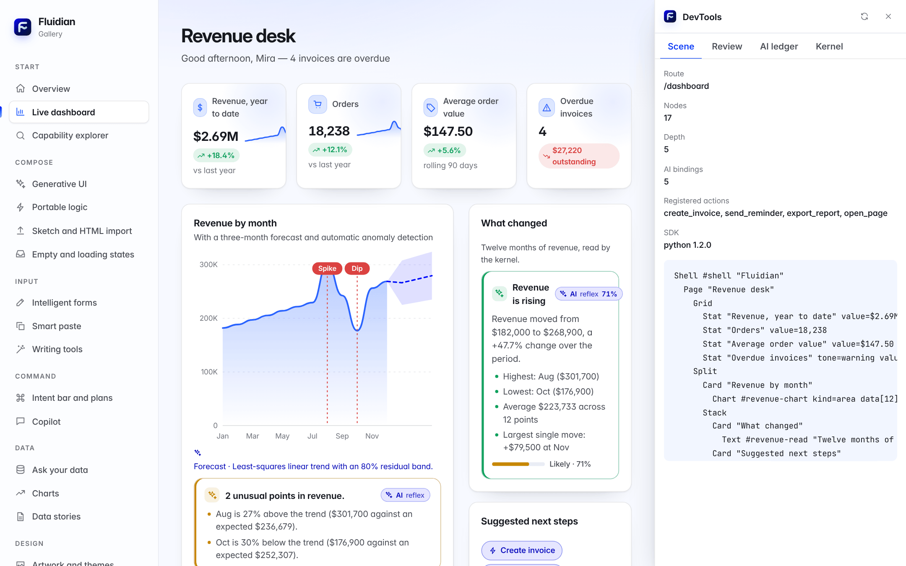

<p align="right"><a href="../README.md"></a></p>

# Developer tools

## In the browser

In development mode (the default for `fluidian run`), press <kbd>Ctrl</kbd>+<kbd>.</kbd> on any page to open the panel.



| Tab | Shows |
| --- | --- |
| **Scene** | Route, node count, depth, number of AI bindings, registered actions, the SDK that produced the scene, and an outline of the tree with ids |
| **Review** | Three reports on the current scene: usability heuristics, accessibility, and structural lint. Selecting a finding highlights the node. |
| **AI ledger** | Every capability call of the session: provider, model, latency, cache hits, and whether it degraded |
| **Kernel** | The routing table, budget, cache statistics and negotiated provider parameters |

Other development aids:

| Shortcut or flag | Effect |
| --- | --- |
| <kbd>Ctrl</kbd>+<kbd>K</kbd> | Opens the Intent Bar. If the page has none, a command palette appears with the app's registered actions. |
| <kbd>Alt</kbd>+click on anything | Asks the kernel to explain that element (`command.point_ask`) |
| Scene-repair badge | Appears when the normaliser had to fix the scene, or when a binding or `@` action in it does not parse; click it to see what and where |
| `?theme=dark`, `?theme=<preset>`, `?density=compact` | Preview the dark scheme, any of the twenty-seven themes, and density |
| `?platform=ios`, `?platform=android` | Preview the control skin of a platform |
| `?bare=1` | Hides development chrome, for screenshots |
| `window.__fluidian.errors()` | Runtime errors caught on the page, with stacks; the browser tests assert this is empty |
| `window.__fluidian.fixes()` | Scene repairs and unparseable logic for the current scene; also asserted empty by the browser tests |
| `window.__fluidian.state()` | A copy of the page's portable state |

Start with `--production` to turn all of this off; the panel's data endpoint is disabled as well.

## On the command line

```bash
./fluidian doctor                         # environment, toolchains, provider
./fluidian features --category data       # list capabilities
./fluidian components                     # list components
./fluidian ai data.insights               # run a capability with its own example
./fluidian ai input.natural_date --input '{"text": "next friday 3pm"}'
./fluidian ai content.summarize --input-file notes.json --mode reflex
./fluidian run --trace -- python3 app.py  # print every protocol message in both directions
./fluidian convert app.py --to go --json  # what an app serves, route by route, and whether a port matches it
./fluidian tokens --theme ocean --format json
```

`fluidian ai` prints the result and its provenance as JSON, which makes it the quickest way to see what a capability returns before you attach it.

## Capabilities for developers

The **dev** family exposes the same tooling as capabilities, so it can be scripted or attached to a page:

| Capability | Use |
| --- | --- |
| `dev.ux_review`, `dev.scene_lint`, `dev.perf_hint` | Review a scene for usability, structure and rendering cost |
| `dev.test_synth` | Derive interaction test cases from a scene |
| `dev.fixtures` | Generate realistic rows for a table schema |
| `dev.scaffold`, `dev.port`, `dev.transpose` | Generate or translate application code between the fourteen languages |
| `dev.error_explain` | Explain a stack trace and list fixes |
| `dev.persona_sim` | Walk a scene as a first-time user, a keyboard user or an expert |
| `dev.diff_narrate` | Describe the difference between two scenes in plain language |

## Static export

```bash
./fluidian export scene.json --out page.html
```

Renders a scene to one self-contained HTML file with no JavaScript. It uses the same component renderers as the browser, so the output matches what a session would show before any interaction.
