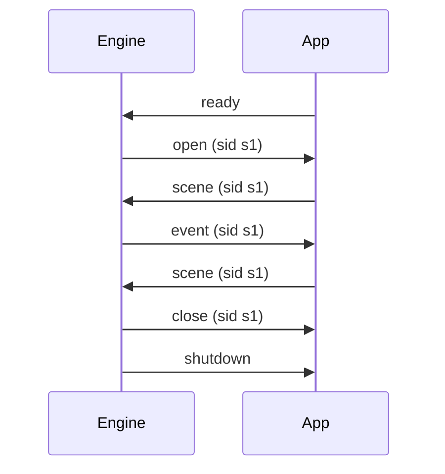

<p align="right"><a href="../README.md"></a></p>

# Wire protocol, version 1

This is the complete contract between the engine and an application. An SDK is an implementation of this page.

## Transport

- The engine starts the application as a child process.
- Messages are **JSON objects, one per line**, UTF-8, terminated by `\n`. The engine writes to the app's stdin and reads its stdout.
- The app must flush stdout after every message and must write nothing else to stdout. Diagnostics go to stderr, which the engine relays to its own log.
- Parsers must accept raw UTF-8 as well as `\uXXXX` escapes, including surrogate pairs. Blank and malformed lines are skipped.
- Every message has a string field `t` naming its type. Unknown types and unknown fields are ignored, which is how the protocol grows.

The engine sets `FLUIDIAN=1` and `FLUIDIAN_PROTOCOL=1` in the app's environment.

## Lifecycle



## Messages from the app

### `ready`
Sent once, first.

```json
{"t":"ready","protocol":1,"sdk":"rust","sdkVersion":"1.2.0",
 "app":{"name":"Invoices","meta":{}},
 "actions":[{"name":"create_invoice","description":"Create a new invoice for a customer","params":{"customer":"string customer name","amount":"number amount in USD"}}]}
```

`actions` lists the handlers that language interfaces may call. A parameter is described by a string that starts with its type (`string`, `number`, `date`, `boolean`) followed by a description.

### `scene`
The complete interface for one session. Sent after `open`, after `route`, and after every handled `event`.

```json
{"t":"scene","sid":"s1","root":{"type":"Page","props":{"title":"Invoices"},"children":[
  {"type":"Button","id":"new","props":{"label":"New invoice"},"on":{"click":{"action":"create_invoice"}}}]}}
```

A node has `type` (string), `props` (object), and optionally `id` (string), `children` (array of nodes), `on` (event name → `{action, payload?}`) and `ai` (array of `{capability, options}`).

### `toast`
`{"t":"toast","sid":"s1","text":"Saved","tone":"success"}` — tone is one of `info`, `success`, `warning`, `danger`.

### `navigate`
`{"t":"navigate","sid":"s1","route":"/invoices/204"}` — changes the browser's route. The SDK also updates its own notion of the session's route, so the scene that follows is rendered for the new route.

### `ai.invoke`
`{"t":"ai.invoke","rid":"r7","sid":"s1","capability":"content.summarize","input":{"text":"…"}}` — `rid` is unique per process. The app then reads messages until the matching `ai.result` arrives. **Any other message received while waiting must be queued and processed afterwards, in arrival order.**

### `log`
`{"t":"log","level":"warn","message":"no handler for action archive"}` — levels are `debug`, `info`, `warn`, `error`.

### `error`
`{"t":"error","sid":"s1","message":"KeyError: 'email'"}` — a handler failed. The SDK must not send a scene for that event; the session keeps its previous one.

## Messages from the engine

### `open`
`{"t":"open","sid":"s1","route":"/","locale":"en-US","viewport":{"w":1280,"h":800}}` — a browser tab connected. Create session state and reply with a `scene`.

### `route`
`{"t":"route","sid":"s1","route":"/settings"}` — the person navigated. Reply with a `scene`.

### `event`
```json
{"t":"event","sid":"s1","name":"submit","target":"contact","value":null,
 "form":{"email":"ada@example.com","seats":3,"terms":true},"payload":null}
```

`name` is the **action name** from the binding, not the DOM event. `target` is the node id. `value` is the component's value where it has one. `form` holds the values of the enclosing form. `payload` is the binding's payload, or the arguments extracted by the kernel when an action is invoked by language.

Run the handler, then send a `scene`. If the session or the handler is unknown, send a `log` at level `warn` and no scene.

### `ai.result`
`{"t":"ai.result","rid":"r7","ok":true,"data":{"title":"…"}}` or `{"t":"ai.result","rid":"r7","ok":false,"error":"budget exceeded"}`.

### `close`
`{"t":"close","sid":"s1"}` — discard the session's state.

### `shutdown`
`{"t":"shutdown"}` — exit with status 0.

## Rules an SDK must follow

1. Session state is isolated by `sid`.
2. Integers stay integers through a round trip: a form value `3` is rendered as `3`, not `3.0`.
3. Strings survive unchanged: quotes, backslashes, control characters, non-ASCII text and emoji.
4. A handler error produces `error` and no `scene`; the process keeps running.
5. Events for unknown sessions or actions produce a `log` at level `warn` and no `scene`.
6. While blocked in `ai.invoke`, other messages are queued and later handled in order.
7. After `shutdown`, the process exits promptly with status 0.

## The conformance suite

`spec/conformance/golden.json` is the reference transcript: 24 messages produced by a scripted session that exercises every rule above, two interleaved sessions, an AI call with an event arriving mid-flight, a failing AI call, navigation, a registered action, an unknown action, a throwing handler, and a scene that contains every component with every kind of prop value.

To verify an SDK:

```bash
./fluidian test --sdk <language>
```

The harness builds the SDK's conformance app, plays the script, normalises each reply and reports the first difference, for example `message 7 (toast): $.text: expected "Saved ada@example.com (pro × 3)", got "Saved ada@example.com (pro × 3.0)"`.

## Writing a new SDK

1. Implement a JSON reader and writer, or use the standard library's.
2. Implement the node builder: `prop`, `id`, `on`, `ai`, `add`.
3. Implement the read loop and the seven rules.
4. Add an emitter for the language in `engine/fluidian/codegen.py` so the component factories and the conformance scene are generated.
5. Port the conformance app (about forty lines) and add the build and run commands to `engine/fluidian/testkit/conformance.py`.
6. Run `./fluidian test --sdk <language>` until the transcript matches.

## Versioning

The protocol version is an integer sent in `ready`. Additions that old SDKs can ignore — new message types, new optional fields — do not change it. A change that requires SDK work increments it, and the engine will support the previous version for at least one major release.
