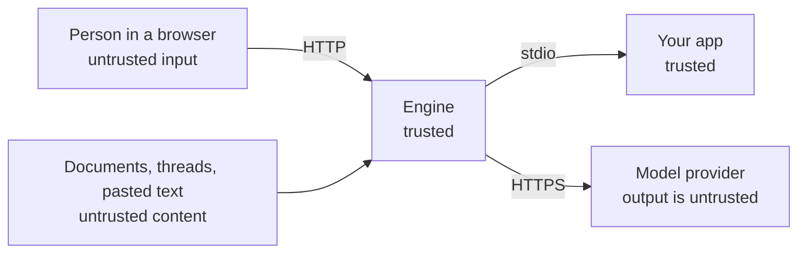

# Security

This page describes what Fluidian defends against, what it leaves to you, and what to check before production. To report a vulnerability, see the [security policy](../SECURITY.md).

## Trust boundaries

The browser, model output and third-party content are untrusted. The engine and your app are trusted and run with the permissions you give them.

## What the engine does

### HTTP surface

| Risk | Defence |
| --- | --- |
| Cross-site request forgery | State-changing requests need the session token in the `X-Fluidian-Token` header; a foreign `Origin` is refused |
| DNS rebinding | Requests whose `Host` is not the bound address or in `FLUIDIAN_ALLOWED_HOSTS` are refused |
| Session hijacking | Session ids and tokens are random and compared in constant time; closing a tab invalidates both |
| Script injection | `Content-Security-Policy` allows scripts and connections only from the engine's origin; `X-Content-Type-Options: nosniff`; `Referrer-Policy: no-referrer` |
| Path traversal | Static files are served only from the runtime directory, after path resolution |
| Resource exhaustion | JSON bodies are limited to 2 MB and media to 12 MB; AI calls are rate-limited per session (burst 30, then 3 per second); at most 500 sessions; idle sessions expire after 30 minutes |

### Rendering

- The runtime builds DOM nodes and never assigns HTML strings, so text from the app, the person or a model cannot become markup.
- The Markdown component supports a fixed subset and does not pass through raw HTML.
- Links and images accept only `http`, `https`, `mailto`, relative URLs and image data URLs.
- Scenes are normalised before rendering: unknown components, props and event bindings are dropped.

### The model path

| Risk | Defence |
| --- | --- |
| Personal data sent to a provider | Emails, phone numbers, card numbers and similar values are replaced by placeholders before the request and restored afterwards. `trust.redact` exposes the same function. |
| Prompt injection through content | Capabilities declare which inputs are untrusted. Those are scored, fenced and labelled; in `block` mode a high score refuses the call. |
| A model inventing actions or UI | Output is validated against a strict schema, actions must be registered by the app, and generated scenes are grounded against the registry |
| A model triggering side effects | Actions run only through your handlers. Capabilities rate risk, and the Approval component puts a person in front of risky steps. |
| Unbounded cost | Per-session and global token budgets; when exhausted the kernel answers locally |
| Unreviewable behaviour | Every call has a trace id and provenance; an optional append-only audit file records metadata and an input hash, never content |
| Processing without agreement | Capabilities that read behavioural signals or the microphone require a consent grant per session |

### Framing, installation and embedding

- **Framing is refused by default.** Every response carries `frame-ancestors 'none'`. Listing origins in `FLUIDIAN_EMBED_ORIGINS` replaces it with exactly those origins; entries that are not plain `http(s)` origins are dropped, so the setting cannot be used to inject other policy directives.
- **The embed element isolates both sides.** `<fluidian-app>` loads the application in a sandboxed frame on the engine's own origin. The host page cannot read the session; the application cannot touch the host page. Messages to the host carry only a route or a height.
- **The service worker caches the shell only.** The page and the runtime's static files are cached so an installed app can start offline. Sessions, scenes, events and AI calls are never cached and always go to the engine.

### Portable logic

Bindings and `@` actions are data in the scene, and scenes can come from a model, so the interpreter assumes hostile input. It is a hand-written parser and tree-walking evaluator with no `eval` and no generated code; it reads only own properties of plain data, refuses `__proto__`, `constructor` and `prototype`, cannot name globals, and can affect the world only through five host calls that pass the same session checks as any request.

### Conversion

`fluidian convert --probe` calls each handler of the source application to observe it. Run it against a development instance. Model translations of handler code are never trusted: one is kept only if the project builds and reproduces every captured scene and probe, and it should still be reviewed like any contribution.

## What is your responsibility

**Authentication and authorisation.** The engine does not know who a person is. Version 1 has no login, and the `open` message carries no identity. Run it behind a component that authenticates people — a reverse proxy with single sign-on, a VPN, an identity-aware gateway — and treat every handler as reachable by anyone who can reach the engine.

**Authorising actions.** A registered action can be invoked by language as well as by a button. Check permissions inside the handler, not in the interface.

**Secrets.** Keep `OPENAI_API_KEY` in the engine's environment. It is not passed to the app or the browser.

**Your data.** Redaction recognises common formats; it is not a classifier for everything sensitive in your domain. Deny capabilities you do not need with `FLUIDIAN_POLICY_DENY`, and review what your handlers pass to `ctx.ai`.

**Transport security.** The engine speaks plain HTTP. Terminate TLS in front of it.

## Production checklist

- [ ] Start with `--production` (no developer tools, no scene-repair details, no error stacks).
- [ ] Bind to a private interface and set `FLUIDIAN_ALLOWED_HOSTS` to the public host name.
- [ ] Put TLS and authentication in front of the engine.
- [ ] Set `FLUIDIAN_SHIELD=block` if your app processes third-party content.
- [ ] Set token budgets that match your cost limits.
- [ ] Set `FLUIDIAN_AUDIT_PATH` and ship the file to your log store.
- [ ] Leave `FLUIDIAN_EMBED_ORIGINS` unset unless another site must frame the app; then list only those origins.
- [ ] Deny unused capability families, for example `FLUIDIAN_POLICY_DENY=modal.*,dev.*`.
- [ ] Run the engine and the app as an unprivileged user with a read-only file system where possible.
- [ ] Run `./fluidian test` in the deployment image.

## Tests that back this page

`tests/engine/test_server.py` covers tokens, origins, hosts, body limits, path traversal and throttling. `tests/engine/test_platforms.py` covers the framing policy, the embed allow-list and the service worker's scope. `tests/runtime/components.test.mjs` covers escaping and URL handling, and `tests/runtime/logic.test.mjs` covers the portable-logic sandbox. `tests/engine/test_kernel.py` and `test_provider.py` cover consent, policy, redaction, the shield and grounding. `tests/engine/test_convert.py` covers the verification gate for converted and model-translated projects.
