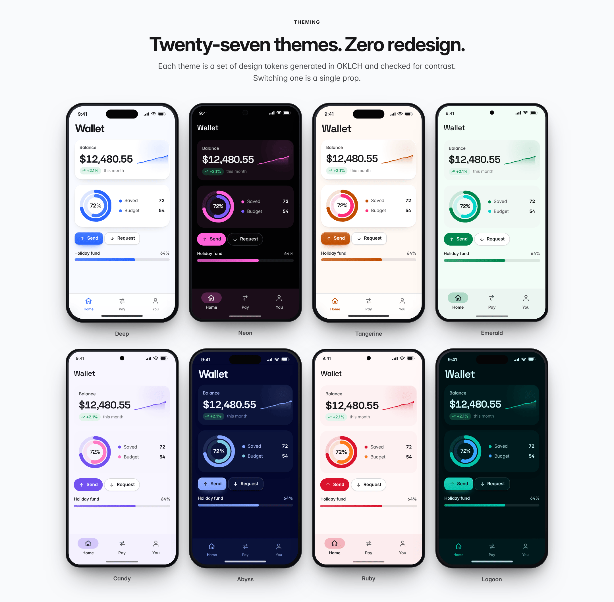
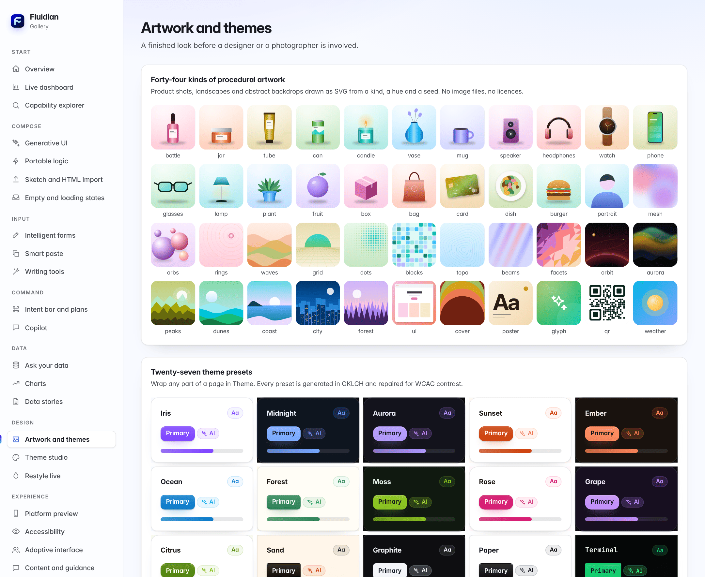

<p align="right"><a href="../README.md"></a></p>

# Theming and artwork

All visual decisions are design tokens: CSS custom properties with the prefix `--fl-`. Components contain no colours, radii, shadows or typefaces of their own, so a theme is a set of token values. It can be applied to a whole application, to one page or to any subtree, and changed at runtime.

## Contents

- [The twenty-seven presets](#the-twenty-seven-presets)
- [Applying a theme](#applying-a-theme)
- [Tokens](#tokens)
- [Typography](#typography)
- [Dark scheme and density](#dark-scheme-and-density)
- [Themes from a sentence](#themes-from-a-sentence)
- [Your own preset](#your-own-preset)
- [Using a theme outside Fluidian](#using-a-theme-outside-fluidian)
- [Artwork](#artwork)
- [Fluidian's own brand](#fluidians-own-brand)
- [Guarantees](#guarantees)

## The twenty-seven presets

A preset sets colour, corner radius, depth and the display typeface together, so switching one changes the character of a screen, not only its hue.

| Preset | Scheme | Brand | Radius | Display typeface |
| --- | --- | --- | --- | --- |
| `deep` (default) | light | `#0000ff` | 14 px | Inter |
| `abyss` | dark | `#3355ff` | 14 px | Inter |
| `iris` | light | `#7b3bff` | 14 px | Inter |
| `midnight` | dark | `#4f8cff` | 14 px | Inter |
| `aurora` | dark | `#a78bfa` | 18 px | Space Grotesk |
| `sunset` | light | `#ee5a2a` | 16 px | Space Grotesk |
| `ember` | dark | `#ff7a45` | 16 px | Space Grotesk |
| `ocean` | light | `#0b7fd1` | 12 px | Inter |
| `forest` | light | `#1f7a4f` | 10 px | Instrument Serif |
| `moss` | dark | `#a3e635` | 14 px | Space Grotesk |
| `rose` | light | `#e11d74` | 18 px | Inter |
| `grape` | dark | `#c084fc` | 18 px | Space Grotesk |
| `citrus` | light | `#5c9a0f` | 16 px | Space Grotesk |
| `sand` | light | `#2a2118` | 4 px | Instrument Serif |
| `graphite` | dark | `#fafafa` | 8 px | Inter |
| `paper` | light | `#111111` | 8 px | Inter |
| `terminal` | dark | `#39ff88` | 3 px | JetBrains Mono |
| `crimson` | dark | `#ff3b5c` | 4 px | JetBrains Mono |
| `candy` | light | `#7c5cff` | 22 px | Space Grotesk |
| `mint` | light | `#0d9f92` | 18 px | Inter |
| `gold` | dark | `#d4af6a` | 4 px | Instrument Serif |
| `sky` | light | `#0c8ce9` | 16 px | Inter |
| `emerald` | light | `#00a862` | 16 px | Space Grotesk |
| `neon` | dark | `#ff2bd6` | 12 px | Space Grotesk |
| `ruby` | light | `#e0142f` | 10 px | Inter |
| `lagoon` | dark | `#14e0c3` | 18 px | Space Grotesk |
| `tangerine` | light | `#ff6a00` | 20 px | Space Grotesk |



Every preset appears in at least one screen of the showcase; the [Screens](gallery.md) page names the theme of each.

## Applying a theme

| Where | How |
| --- | --- |
| A whole application | Return a `Theme` node as the root of the scene: `ui.theme(page).prop("preset", "ocean")` |
| One region | Wrap any subtree in a `Theme` node; themes nest |
| One page load | Add `?theme=ocean` to the address; this wins over the scene's own theme |
| An embedded app | `<fluidian-app theme="ocean">` |
| A device preview | `ui.device_frame(scene).prop("theme", "midnight")` |
| From application state | Set the preset from `ctx.state`, and the page restyles on the next render without a reload |

```python
@app.view
def view(ctx):
    return ui.theme(
        ui.shell("Field Notes", page(ctx)),
    ).prop("preset", ctx.state.get("theme", "forest"))
```

A `Theme` node also accepts `scheme` (`light` or `dark`) to force a variant, and `tokens` (a list of `{name, value}`) to override individual tokens for its subtree.

## Tokens

| Token | Role |
| --- | --- |
| `--fl-bg`, `--fl-surface`, `--fl-surface-2`, `--fl-surface-3` | Page background and raised surfaces |
| `--fl-border`, `--fl-border-strong` | Hairlines and emphasised borders |
| `--fl-text`, `--fl-text-2`, `--fl-text-3` | Primary, secondary and tertiary text |
| `--fl-brand`, `--fl-brand-2`, `--fl-brand-soft`, `--fl-brand-text`, `--fl-on-brand` | Brand fills, tints, brand-coloured text, and text on brand |
| `--fl-accent` | Secondary accent |
| `--fl-success`, `--fl-warning`, `--fl-danger`, `--fl-info` and their `-soft` variants | Status colours and tints |
| `--fl-ai-a`, `--fl-ai-b`, `--fl-ai-c`, `--fl-ai-soft` | The gradient and tint that mark generated content |
| `--fl-radius` | Corner radius; components derive their own radii from it |
| `--fl-font`, `--fl-font-display` | Body and display typefaces |
| `--fl-display-weight`, `--fl-display-tracking`, `--fl-display-scale`, `--fl-display-accent` | How headlines are set: weight, letter spacing, optical size and the style of highlighted words |
| `--fl-shadow-1`, `--fl-shadow-2`, `--fl-shadow-3`, `--fl-inset` | Elevation, tuned per preset and scheme |
| `--fl-scheme` | `light` or `dark` |

The token files are generated: `runtime/tokens.css` holds the default light and dark pair, `runtime/themes.css` one block per preset. Colours are derived in the **OKLCH** space, where equal steps look equal, and every text and surface pair is checked against WCAG contrast before it is written.

To override a token by hand, load your own stylesheet after the framework's:

```css
:root { --fl-brand: #0f766e; --fl-radius: 6px; }
```

## Typography

Four typefaces are bundled as variable or static WOFF2 files, all under the SIL Open Font License, and the system UI font is the fallback.

| Family | Used for |
| --- | --- |
| **Inter** | Body text everywhere, and display text in the `sans` presets |
| **Space Grotesk** | Display text in the `grotesk` presets: tight, geometric headlines |
| **Instrument Serif** | Display text in the `serif` presets, with italic for highlighted words |
| **JetBrains Mono** | Code, terminals, and both display and body text in `terminal` |

Headlines can highlight words with the `highlight` prop of `Hero`, `Band`, `CTA` and `PromoTile`; the highlight is a gradient in sans presets and an italic in serif presets, so the same scene keeps a suitable emphasis under any theme. Numbers in tables and statistics use tabular figures.

## Dark scheme and density

Every preset has a fixed scheme; the default theme has both. The dark tokens of the default theme live under `[data-scheme="dark"]`.

| Mechanism | Effect |
| --- | --- |
| `?theme=dark` in the URL | Dark scheme of the default theme for this page load |
| `Theme` with `scheme` | Forces light or dark for a subtree |
| `?density=compact`, `comfortable` or `spacious` | Scales control heights and spacing |
| `design.dark_mode` | Returns a dark token set derived from a brand colour |
| `adapt.density` | Suggests a density from the scene and the person's context |

## Themes from a sentence

`design.theme_prompt` turns a description into a complete, contrast-checked token set, and the `theme` presenter applies it to the document without a reload:

```python
ui.text("Themed for the evening").ai("design.theme_prompt", {"prompt": "calm fintech at night"})
```

From application code:

```python
theme = ctx.ai("design.theme_prompt", {"prompt": "sunny citrus market"})
theme["brand"], theme["accent"], theme["dark"], theme["radius"]   # '#c14978', '#4ebf6a', False, 12
theme["tokens"]                                                    # [{"name": "--fl-bg", "value": "#…"}, ...]
```

Related capabilities: `design.palette` (an eleven-step ramp and harmonies from a seed), `design.contrast_heal` (repairs failing pairs with the smallest perceptual change), `design.brand_extract` (a theme from a description or image of a brand), `design.type_pair` (typefaces by mood) and `design.token_lint` (finds hard-coded values that should be tokens). The *Theme studio* and *Restyle live* pages of the gallery show all of them.

## Your own preset

Presets are entries in `THEMES` in `engine/fluidian/colors.py`:

```python
"harbour": {"label": "Harbour", "brand": "#0f766e", "accent": "#f59e0b", "radius": 10,
            "neutral_hue": 190, "neutral_chroma": 0.012, "display": "grotesk"},
```

| Key | Meaning |
| --- | --- |
| `brand`, `accent` | The two seed colours; everything else is derived |
| `dark` | `True` for a dark preset |
| `radius` | Corner radius in pixels |
| `neutral_hue`, `neutral_chroma` | The tint of greys and surfaces |
| `depth` | Shadow strength |
| `ai` | Three colours for the gradient that marks generated content |
| `display`, `body` | `sans`, `grotesk`, `serif` or `mono` |
| `mono` | Use the monospaced face for everything |

Then regenerate the stylesheets and check the result:

```bash
python3 tools/build_tokens.py     # rewrites runtime/tokens.css, themes.css and themes.js
./fluidian test --quick           # contrast is asserted for every preset
```

## Using a theme outside Fluidian

`fluidian tokens` exports any preset as CSS, SCSS, JSON, W3C design tokens, a Tailwind preset, SwiftUI, Android resources, Jetpack Compose or Flutter, so a marketing site or a native app can match exactly:

```bash
./fluidian tokens --theme ocean --format tailwind > fluidian-ocean.tailwind.js
./fluidian tokens --theme all --format all -o design-tokens
```

See [Cross-platform](cross-platform.md#design-tokens).

## Artwork

The `Art` component draws illustrations as inline SVG from a few props. Nothing is downloaded and nothing is stored, so a storefront, a landing page or a set of cards can be complete without a single image file, and artwork follows the theme.

```python
ui.art("bottle").prop("hue", 28).prop("label", "Olea")          # a product shot with a label on it
ui.art("coast").prop("hue", 205).prop("ratio", "16:9")          # a landscape
ui.art("portrait").prop("seed", 7)                               # the seed picks a variation
ui.art("mesh")                                                   # with no hue, it uses the theme's own colours
```

| Group | Kinds |
| --- | --- |
| Products | `bottle`, `jar`, `tube`, `can`, `candle`, `vase`, `mug`, `speaker`, `headphones`, `watch`, `phone`, `glasses`, `lamp`, `plant`, `fruit`, `box`, `bag`, `card`, `dish`, `burger`, `portrait` |
| Abstract | `mesh`, `orbs`, `rings`, `waves`, `grid`, `dots`, `blocks`, `topo`, `beams`, `facets`, `orbit`, `aurora` |
| Places | `peaks`, `dunes`, `coast`, `city`, `forest`, `weather` |
| Graphic | `ui`, `cover`, `poster`, `glyph`, `qr` |

| Prop | Meaning |
| --- | --- |
| `hue`, `hue2` | Base and secondary hue in degrees; omit them to follow the theme |
| `seed` | A number that selects a variation of the drawing |
| `ratio` | `1:1`, `4:3`, `3:2`, `16:9`, `21:9`, `3:4`, `2:3`, `9:16`, `2:1`, `3:1`, `5:4`, `4:5` |
| `label` | Text drawn into the artwork: the name on a bottle, a cover or a poster |
| `variant`, `glyph` | A kind-specific variant; the icon shown by the `glyph` kind |
| `tone` | `light` or `dark` backdrop |
| `bare` | Product kinds only: draw the subject with no backdrop |
| `width`, `fit` | A fixed width; `cover` or `contain` |
| `rounded`, `shadow` | Round the corners; raise with a shadow |
| `caption`, `alt` | A caption over the artwork; the accessible description |



`ProductCard`, `PromoTile` and `Player` accept an `art` prop with the same fields, and `Art` can be placed inside any container, such as a `Card`, a `Feature`, a `Bento` cell or a `Hero`.

## Fluidian's own brand

The logo and the wordmark use one palette, Deep Blue, defined once as `BRAND` in [`engine/fluidian/colors.py`](../engine/fluidian/colors.py). The default theme (`deep`) and the default dark scheme (the same tokens as `abyss`) are derived from it. That palette is the identity of the framework, not of what you build with it: every other preset has its own colours, and the showcase uses all twenty-seven.

| Name | Value | Where it appears |
| --- | --- | --- |
| Blue | `#0000ff` | The top of the logo tile; the dots of the wordmark on light pages; the seed of the `deep` theme |
| Navy | `#000c66` | The middle of the logo tile |
| Midnight | `#050a30` | The foot of the logo tile; the wordmark on light pages; the page colour of the dark scheme |
| Sky | `#7ec8e3` | The end of the ribbon; the dots of the wordmark on dark pages; the accent colour |
| White | `#ffffff` | The start of the ribbon; the wordmark on dark pages |

The mark is a ribbon: one stroke bends from the top arm of an F into its stem, and the crossbar is a wave.

<p>
  
  &nbsp;&nbsp;
  <picture><source media="(prefers-color-scheme: dark)" srcset="assets/wordmark-dark.svg"></picture>
</p>

| File | Use |
| --- | --- |
| [`docs/assets/logo.svg`](assets/logo.svg) | The mark on its tile. Also served as the favicon (`runtime/logo.svg`) |
| [`docs/assets/mark.svg`](assets/mark.svg) | The mark alone, in blue, for a light background of your own |
| [`docs/assets/wordmark.svg`](assets/wordmark.svg), [`wordmark-dark.svg`](assets/wordmark-dark.svg) | The mark with the name, for light and dark pages. The letters are outlines, so no font is needed |
| [`docs/assets/banner.svg`](assets/banner.svg) | The banner at the top of the README |
| `runtime/pwa/*.png` | Icons for the installable web app |

All of them, and the mark the runtime draws (`runtime/brand.js`), come from one script:

```bash
python3 tools/brand.py            # needs fonttools, brotli and rsvg-convert
```

In an application, `logo="fluidian"` on `NavBar` or `Footer` draws the mark. Your own application keeps its own identity: every other value of `logo` picks a neutral geometric shape, and `Shell`, `NavBar` and `Footer` show the Fluidian mark by default only when their brand is Fluidian.

## Guarantees

- No theme is applied unchecked. Body text meets at least 7:1 against the page and 4.5:1 against surfaces, and text on the brand colour meets 4.5:1. The test suite asserts this for all twenty-seven presets and for generated themes in both schemes.
- Status colours keep their meaning across themes; only their tints follow the brand.
- Content marked as generated always uses the AI gradient, so a person can tell at a glance what a model wrote.
